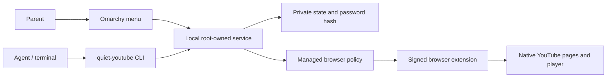

# Architecture

## Components

| Path | Responsibility |
| --- | --- |
| `src/core.js` | Settings, managed precedence, channel/video metadata parsing |
| `src/background.js` | Extension messaging, public metadata requests and caches |
| `src/content.js`, `src/native-feed.js`, `extension/content.css` | Native YouTube page filtering, routing and player checks |
| `src/guard.js` | Page-context media guard; this is a known weak boundary against page JavaScript |
| `src/ui.jsx`, `src/ui.css` | Browser popup/settings demo; read-only for managed rules |
| `native/quiet_youtube/service.py` | Unix socket API, password checks, session expiry, validation, persistence and browser policy |
| `native/quiet_youtube/cli.py` | CLI and panel transport, JSON output and private CLI session storage |
| `omarchy/QuietYouTube.qml` | Bar icon and parent menu |
| `packaging/` | User/system installers, CRX3 signing and systemd unit |
| `browser-extension/` | Committed build for direct Omarchy Git installation |

## Authentication and policy

The service uses kernel Unix-socket peer credentials to identify callers. A parent session is a random token bound to that UID and a fixed 900-second deadline. Closing the visible menu preserves the session; the explicit **Close** action revokes it. A parent can issue a separate CLI grant with the same or earlier deadline. Password changes revoke all sessions. Service restarts lose sessions while preserving settings and guessing limits.

The service generates machine-wide browser policy. That policy force-installs a device-signed extension and passes the full `ParentSettings` object through managed storage. Local browser settings cannot override it. Pausing protection keeps the installation and browser restrictions in place but releases the YouTube filtering rules.

Initial setup and password recovery require administrator access. Menu/CLI changes require a valid parent session. Password hashing uses scrypt with a random salt. No password or token belongs in subprocess arguments or logs.

## Channel filtering

A channel approval is a stable YouTube channel ID, not just a display name. Native-feed cards and supported video/embedded URLs are checked against this allowlist. Shorts classification uses metadata rather than video duration. Missing verification keeps supported playback blocked. YouTube is a single-page application, so navigation and recycled cards are rechecked.

Public metadata is fetched without API credentials using YouTube's undocumented public-page `ucbcb=1` parameter. Layout/metadata changes, consent behavior and access restrictions can require maintenance. This is not a Google subscription synchronization service.

See [security](../SECURITY.md) for the trust boundary, [privacy](PRIVACY.md) for data handling, and [parent controls](PARENT-CONTROLS.md) for installation paths.
